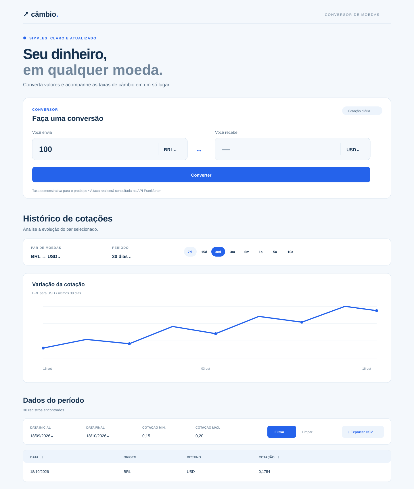
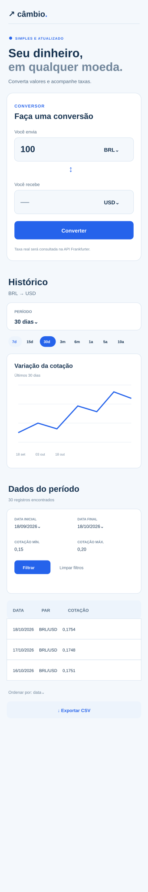

# Conversor de Moedas

Aplicação de página única para converter valores entre moedas e consultar cotações históricas. Os dados vêm da API pública [Frankfurter v2](https://frankfurter.dev/). A conversão é informativa: o projeto não compra, vende nem transfere dinheiro.

## Funcionalidades

- Lista de moedas carregada da API e consulta da cotação mais recente do par selecionado.
- Conversão calculada no navegador, com apresentação da taxa e da data efetiva retornadas pela API.
- Inversão entre as moedas de origem e destino.
- Histórico em gráfico e tabela nos períodos de 7, 15 e 30 dias; 3 e 6 meses; 1, 5 e 10 anos.
- Filtros combináveis por datas e por cotação, ordenação por data ou cotação e contagem de resultados.
- Exportação CSV dos registros filtrados e ordenados.
- Estados de carregamento, erro, ausência de dados e validação de entrada.
- Layout responsivo com estilos de componente em CSS Modules.

## Tecnologias

- React 19, JavaScript e Vite
- Recharts para o gráfico histórico
- Frankfurter API v2, sem chave de acesso

## Executar localmente

Requer Node.js e npm instalados.

```bash
npm install
npm run dev
```

O terminal mostrará o endereço local do servidor Vite. Para criar e servir a versão de produção:

```bash
npm run build
npm run preview
```

Para verificar o lint:

```bash
npm run lint
```

## Organização do código

```text
src/
  components/       Componentes React e seus CSS Modules
  hooks/            Consultas e estados de moedas e histórico
  services/         Chamadas à Frankfurter API v2
  utils/            Cálculo de intervalos de data
  App.jsx           Composição da página e estado compartilhado do par
  App.module.css    Layout geral e cartão do conversor
  index.css         Reset, variáveis e estilos globais básicos
```

`App` mantém o par de moedas e o compartilha com o conversor e o histórico. `useCurrencies` carrega as moedas; `useHistoricalRates` consulta a série do período. `ConverterForm` busca a taxa mais recente e calcula o valor no navegador. `HistorySection` aplica filtros e ordenação, alimenta a tabela e o CSV, e mantém o gráfico com a série completa retornada.

## Referências visuais

Os SVGs abaixo são protótipos de referência; valores e datas são ilustrativos e não constituem capturas da aplicação em execução.





## Documentação

- [Requisitos](docs/REQUIREMENTS.md)
- [Componentes e fluxo de dados](docs/COMPONENTS.md)
- [Testes funcionais](docs/FUNCTION_TESTS.md)
- [Testes da API](docs/API_TESTS.md)
- [Figma e protótipos](docs/FIGMA.md)
- [Registro de uso de IA](docs/AI_USAGE.md)

## API

O serviço em `src/services/frankfurter.js` usa os endpoints `/v2/currencies`, `/v2/rate/{base}/{quote}` e `/v2/rates`. As chamadas são feitas com `fetch`; a aplicação apresenta estados de carregamento e erro quando uma consulta não pode ser concluída.
